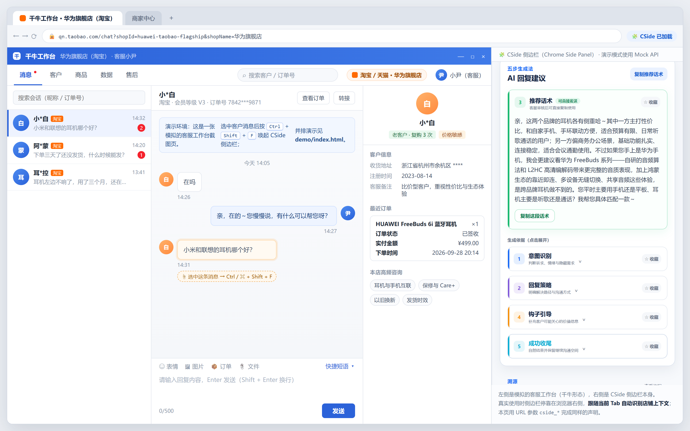
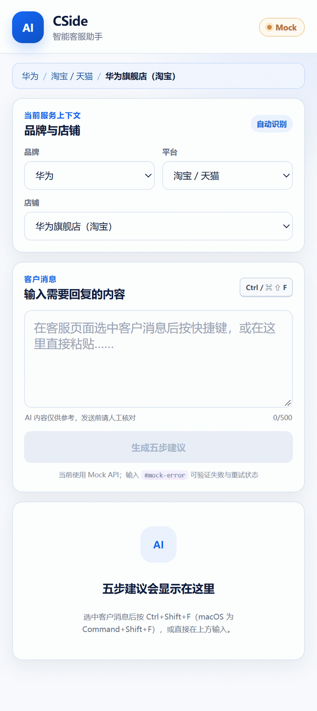
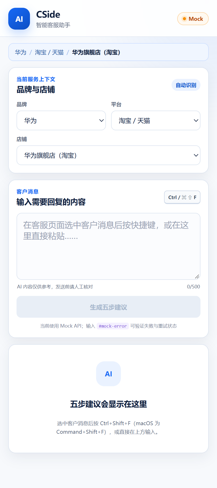
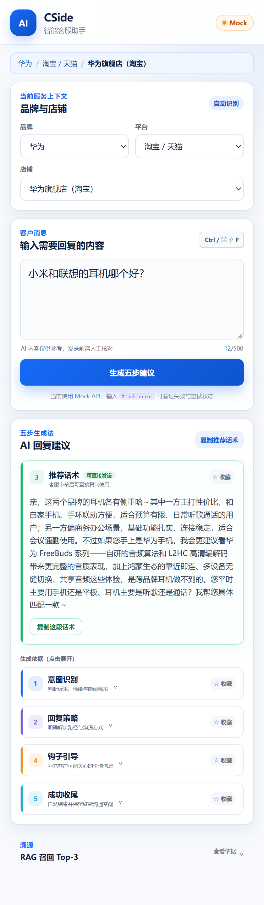
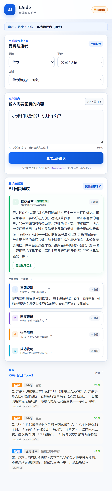
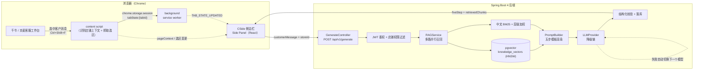

<div align="center">

# CSide · 电商智能客服 AI 副驾驶

**客服在千牛 / 京麦里选中客户消息 → `Ctrl / ⌘ + Shift + F` → 侧边栏给出可审核、可溯源、可一键复制的五步回复**

[](https://zjzjy.github.io/cside-ai-copilot/)
[](#十测试与质量)
[](LICENSE)




<sub>左：模拟的客服工作台（千牛形态）｜右：CSide 侧边栏 —— <b>推荐话术置顶常驻</b>，其余四步默认收起，「溯源」按需展开</sub>

</div>

> **English TL;DR** — CSide is a Chrome Side Panel AI copilot for multi-brand e-commerce customer-service teams. It picks up the customer message from the agent console, retrieves brand / store knowledge with hybrid search (self-implemented Chinese BM25 + pgvector cosine over a three-level knowledge base), and returns a **five-step, auditable reply** (intent → strategy → script → hook → close) with the retrieved sources. The agent reviews and copies; nothing is auto-sent. Stack: Spring Boot 4 · React 19 · Chrome MV3 Side Panel · PostgreSQL/pgvector · DeepSeek → Qwen → Hunyuan fallback chain.

---

## 目录

- [一、这是什么](#一这是什么)
- [二、先看效果](#二先看效果)
- [三、产品设计：六个关键判断](#三产品设计六个关键判断)
- [四、系统架构](#四系统架构)
- [五、功能与交付状态](#五功能与交付状态)
- [六、快速开始（安装与运行）](#六快速开始安装与运行)
- [七、本地演示（含模拟客服工作台）](#七本地演示含模拟客服工作台)
- [八、二次开发指南](#八二次开发指南)
- [九、数据与知识库](#九数据与知识库)
- [十、测试与质量](#十测试与质量)
- [十一、开发计划（路线图）](#十一下一步开发计划路线图)
- [十二、文档索引与团队](#十二文档索引与团队)

---

## 一、这是什么

| | 说明 |
| --- | --- |
| **给谁用** | 电商代运营客服：一个人同时管多品牌（vivo / OPPO / 小米 / 华为）、多平台（淘宝天猫 / 京东 / 拼多多 / 抖音）、多店铺 |
| **解决什么** | ① 话术质量鸿沟：资深客服与新人产出差距大；② 效率瓶颈：大促同时接待 20 人，首响时长考核压力大；③ 经验流失：话术存在个人脑子里，客服年流失率 25%–40% |
| **怎么解决** | 知识库 + 检索增强生成：按「店铺 > 品牌 > 通用」三级继承召回知识，用五步结构化协议输出**可审核、可溯源**的话术，客服改完再发 |
| **现在到哪** | MVP 已跑通全链路（扩展 → 后端 RAG + LLM → PostgreSQL 落库），52 项自动化测试；迭代二（Agent 编排 + 多模态输入）见[路线图](docs/ROADMAP.md) |

一句话产品定位：**不是替客服回消息的机器人，而是把资深客服的判断过程（看意图 → 定策略 → 出话术 → 留钩子 → 收尾）做成可复用的流程。**

---

## 二、先看效果

### 交互流程（约 6 秒）



### 三个界面状态

| 初始状态 | 生成结果（推荐话术置顶） | 展开依据 + 溯源 |
| --- | --- | --- |
|  |  |  |

### 在线演示（不用装任何东西）

**https://zjzjy.github.io/cside-ai-copilot/**

打开后会看到「模拟客服工作台 + CSide 侧边栏」并排演示：在侧边栏输入客户消息、点「生成五步建议」，就能看到完整交互。

> 在线演示运行在**演示模式**（`?cside_demo=1`）：不连后端、不调真实大模型，返回的是取自本仓库品牌知识库种子数据的 Mock 结果，用于离线/公网展示交互与信息结构。
> 想接真实 LLM，见[快速开始](#六快速开始安装与运行)。

---

## 三、产品设计：六个关键判断

### 1. 输出「五步」，而不是一段话

模型直接写一段话术，客服无法复用也无法审计。五步协议把资深客服的思考过程显式拆开：

| 步骤 | 作用 | 对产品意味着什么 |
| --- | --- | --- |
| ① 意图识别 | 判断诉求、情绪、隐藏需求 | 可评估「理解对不对」 |
| ② 回复策略 | 明确解决路径与沟通口径 | 可版本化、可培训（新人学的是策略，不是话术背诵） |
| ③ 推荐话术 | 可直接复制发送的正文 | 客服 90% 的注意力只需要这一段 → **置顶常驻** |
| ④ 钩子引导 | 补充促成/价值信息 | 承接转化目标 |
| ⑤ 成功收尾 | 自然结束并保留沟通空间 | 降低「对话被聊死」 |

配套的取舍：**五步 ≠ 五屏**。绝大多数场景客服只关心第 3 步，所以第 ③ 步默认展开并置于顶部，其余四步收进「生成依据（点击展开）」；「溯源」也同样默认收起。把审核用的信息留在伸手可及处，但不占用主流程注意力。

### 2. 用单 Agent + RAG，不做 ReAct 工具编排（MVP）

客服场景的核心是「在正确的知识上生成正确的话术」，不是多步推理。ReAct 的 Think-Act-Observe 循环会拉长响应时间（客服侧对首响有分秒级考核），且多数会话不需要多轮工具交互。因此 MVP 用单模型直接完成「意图 → 策略 → 话术」生成，把复杂度放在检索质量和结构化输出上。

> 迭代二会把工具调用决策交给模型，并设置明确的降级门槛：Tool 调用准确率 < 80% 就退回单 Agent 方案（设计见 [docs/技术梳理.md](docs/技术梳理.md)）。

### 3. 知识库分三级：店铺 > 品牌 > 通用

代运营的业务约束是「同一句政策，不同品牌、不同店铺口径不同」。因此知识库按继承关系组织，检索时按优先级合并、按品牌隔离、过滤禁用语：

| 层级 | 占比 | 说明 |
| --- | --- | --- |
| 通用层 | 约 80% | 平台规则、通用话术（全矩阵共享） |
| 品牌层 | 约 15% | 品牌 FAQ、商品参数、品牌口径（按品牌隔离） |
| 店铺层 | 约 5% | 只存差异项（活动、店铺自身规则） |

检索用自实现的中文 BM25 + pgvector 余弦混合打分：`最终分数 = 0.75 × 归一化 BM25 + 0.20 × 向量余弦 + 层级 boost`（店铺 +0.05 / 品牌 +0.03 / 通用 0）。中文 BM25 用「汉字 1-gram + 2-gram」组合切分（如「耳机不响」→ 耳 / 耳机 / 机 / 机不 / 不 / 不响 / 响），兼顾召回与词序信息。

### 4. 结构化输出要有三层兜底，不能让 UI 崩在模型上

| 层 | 手段 |
| --- | --- |
| 主动预防 | `response_format=json_object` + `temperature=0.2` + Prompt 内显式声明 Schema |
| 被动检测 | JSON 解析 → 五项字段完整性校验 → 第 3 步长度校验，缺失即整条作废并切换下一个模型 |
| 降级兜底 | 部分缺失标灰展示；完全失败降级为纯文本提示；失败 case 落库驱动 Prompt 迭代 |

同时配置模型降级链：**DeepSeek V4 Flash → Qwen3.5 Plus → 腾讯混元 Hy3**（顺序在 `.env` 里可配，未配置 Key 的节点自动跳过）。

### 5. 溯源是「信任基础设施」，不是卖点装饰

客服敢不敢用 AI 给的话术，取决于能不能快速核对「这句话是根据什么说的」。所以每次生成都返回 RAG 召回的 Top-3 知识片段（来源 ID、层级、场景、分数）。产品上它被刻意做「轻」——默认收起，需要核对时再展开；AI 生成的内容永远标注「仅供参考，发送前请人工核对」，**产品不做自动发送**。

### 6. 收藏即数据飞轮

不搞复杂的 L0–L4 分层，只用零摩擦的一步：**客服收藏哪一步，就说明哪一步有价值**。收藏自动带上品牌/步骤标签，进入微调初筛数据集；对话同时记录「AI 生成版」与「人工实际发送版」，两者的差异就是人类偏好信号，可沉淀为后续 DPO / 专属客服模型的训练素材。

---

## 四、系统架构



### 一次生成请求发生了什么

1. 客服在页面选中客户消息，`Ctrl / ⌘ + Shift + F` 触发；content script 抓取选区，并把「品牌 / 平台 / 店铺」上下文写入当前 Tab 的状态。
2. 侧边栏读取状态后自动填充消息与店铺上下文（也可手动切换店铺，避免把 A 店话术发给 B 店客户）。
3. 侧边栏调用 `POST /api/v1/generate`，后端做 JWT 鉴权与店铺权限过滤，执行多路召回（FAQ / 话术模板 / 商品 / 政策）。
4. `PromptBuilder` 把「店铺上下文 + 召回知识 + 最近对话 + 客户消息」渲染进五步模板，调用 LLM 降级链。
5. 返回前做结构化校验与落库；响应同时带 `retrievedChunks`，侧边栏展示溯源。

### 技术栈

| 层级 | 选型 |
| --- | --- |
| 侧边栏 | React 19 + TypeScript + Chrome Extension Manifest V3（Side Panel API） |
| 管理后台 | React 19 + TypeScript + Ant Design 5 |
| 后端 | Spring Boot 4.0.3 + JDK 21 + Spring Security(JWT) |
| 数据 | PostgreSQL 16 + pgvector（HNSW 索引）+ Redis 7 |
| LLM | DeepSeek V4 Flash → Qwen3.5 Plus → 腾讯混元 Hy3（可配置降级链） |
| Embedding | BAAI/bge-large-zh-v1.5（1024 维）+ Hugging Face TEI |
| 部署 | Docker Compose（postgres / redis / embeddings 三个服务） |
| 测试 | Vitest（单元）+ Playwright（组件 E2E / 扩展全链路 E2E）+ JUnit 5 |

### 关键接口

```http
POST /api/v1/generate
Authorization: Bearer <jwt>
Content-Type: application/json

{
  "customerMessage": "小米和联想的耳机哪个好？",
  "conversationId": 12,
  "brand": "huawei",
  "platform": "taobao",
  "storeId": "huawei-taobao-flagship"
}
```

```json
{
  "code": 0,
  "message": "success",
  "data": {
    "conversationId": 12,
    "brand": "huawei",
    "platform": "taobao",
    "storeId": "huawei-taobao-flagship",
    "fiveStep": {
      "step1Intent": "客户在询问跨品牌耳机对比……",
      "step2Strategy": "不贬低其他品牌，客观简述两家特点……",
      "step3Script": "亲，这两个品牌的耳机各有侧重哈～……",
      "step4Hook": "现在入手 FreeBuds 系列还能搭配华为 Care+ 服务……",
      "step5Close": "亲您把平时用的设备告诉我，我马上帮您选出最合适的一款～"
    },
    "retrievedChunks": [
      {
        "sourceId": "HW-FAQ-002",
        "sourceType": "faq",
        "level": "brand",
        "brand": "huawei",
        "scene": "售前",
        "content": "Q: 鸿蒙系统和安卓有什么区别？……",
        "score": 0.78
      }
    ]
  }
}
```

完整接口与错误码见 [docs/api/README.md](docs/api/README.md)、[docs/api/error-codes.md](docs/api/error-codes.md)（后端共 12 个 REST 端点，Swagger UI 见 `/swagger-ui.html`）。

---

## 五、功能与交付状态

| 模块 | 能力 | 状态 |
| --- | --- | --- |
| 侧边栏 | 店铺上下文自动识别 / 手动切换、消息输入与快捷键抓取、五步生成、推荐话术置顶、分步收藏、复制、溯源展示 | 已完成 |
| 侧边栏 | Mock / 真实 API 一键切换（无后端也能演示全流程） | 已完成 |
| 后端 | JWT 登录、五步生成、RAG 混合检索、收藏、对话历史、品牌/店铺配置、知识导入 | 已完成 |
| 后端 | 模型降级链、结构化输出三层兜底、RAG 缓存复用（`messages.metadata`） | 已完成 |
| 管理后台 | 登录、品牌配置、店铺配置（品牌 + 平台 + 店铺三级可配置） | 已完成 |
| 数据 | 7 张表 DDL、种子数据（华为 / vivo 两品牌 + 平台政策 + 通用话术）、知识导入脚本 | 已完成 |
| 工程 | 一键安装 / 启动脚本、Docker Compose、52 项自动化测试、dist 自包含校验 | 已完成 |
| Agent 编排 / 多模态输入 / 评估报告 / 知识缺失自发现 | 迭代二设计完成，见[路线图](docs/ROADMAP.md) | 规划中 |

---

## 六、快速开始（安装与运行）

### 环境要求

| 依赖 | 版本 | 说明 |
| --- | --- | --- |
| JDK | 21 | 后端（Spring Boot 4 要求 21+） |
| Node.js | 20 LTS+ | 扩展与管理后台 |
| Docker Desktop | 4.30+ | PostgreSQL + pgvector、Redis、Embedding 服务 |
| Chrome | 116+ | 支持 Side Panel API |

### 方式 A：Windows 一键脚本（推荐）

```powershell
# 1) 安装依赖 + 初始化数据库 + 构建（首次执行，约 5-10 分钟，其中 TEI 模型下载最慢）
.\setup.bat

# 2) 启动容器 + 后端 + 管理后台
.\start.bat

# 3) 构建扩展，然后在 Chrome 里加载
cd frontend\extension
npm run build      # 产物在 frontend/extension/dist
```

加载扩展：Chrome 打开 `chrome://extensions/` → 打开右上角「开发者模式」→「加载已解压的扩展程序」→ 选择 `frontend/extension/dist` → 点击工具栏的 CSide 图标打开侧边栏。

### 方式 B：手动安装（macOS / Linux / 想自己控每一步）

```bash
# 1) 准备配置：复制模板并至少填一个 LLM API Key
cp .env.example .env

# 2) 启动 PostgreSQL + pgvector / Redis / Embedding 服务
docker compose --env-file .env -f docker/docker-compose.yml up -d

# 3) 建表（首次）
docker exec -i cside-db psql -U cside -d cside < data/schema.sql

# 4) 启动后端（默认 http://localhost:8181，Swagger: /swagger-ui.html）
cd backend && ./mvnw spring-boot:run

# 5) 侧边栏开发模式（热更新）
cd frontend/extension && npm install && npm run dev

# 6) 管理后台
cd frontend/admin && npm install && npm run dev
```

后端启动时会自动导入 `data/seed` 下的种子知识（`KnowledgeImportRunner`），首次启动会为每条知识生成 Embedding，耗时取决于机器性能。

### 环境变量（节选）

完整清单与默认值见 [.env.example](.env.example)；**`.env` 已被 Git 忽略，请勿提交密钥**。

| 变量 | 默认值 | 说明 |
| --- | --- | --- |
| `LLM_PROVIDER` | `real` | `real` 走真实大模型；侧边栏也可以切到 Mock 模式离线演示 |
| `LLM_FALLBACK_ORDER` | `deepseek,qwen,hunyuan` | 降级顺序，未配置 Key 的节点自动跳过 |
| `LLM_DEEPSEEK_API_KEY` / `LLM_QWEN_API_KEY` / `LLM_HUNYUAN_API_KEY` | 空 | 至少填一个 |
| `LLM_TEMPERATURE` / `LLM_MAX_TOKENS` | `0.2` / `1200` | 结构化输出需要低温度 |
| `EMBEDDING_MODEL` / `EMBEDDING_DIMENSIONS` | `BAAI/bge-large-zh-v1.5` / `1024` | 更换模型必须同步迁移向量维度 |
| `EMBEDDING_DOCKER_IMAGE` | `ghcr.io/huggingface/text-embeddings-inference:cpu-ipex-latest` | 首次启动会下载模型 |
| `RAG_QUERY_INSTRUCTION` | `为这个句子生成表示以用于检索相关文章：` | bge 系列建议加指令前缀 |
| `DB_*` / `REDIS_*` / `JWT_SECRET` / `SERVER_PORT` | 见模板 | 本地开发默认可用；生产务必改 `JWT_SECRET` |

### 常见问题

| 现象 | 处理 |
| --- | --- |
| 后端启动慢、Embedding 首次下载模型 | 正常现象，TEI 首次要拉取 bge 模型（约 1–2 GB），后续启动走缓存 |
| 数据库里向量维度是 768，检索报错 | 执行 `data/migrations/002_embedding_bge_large_zh_v1_5.sql` 迁移后重新导入知识 |
| `port is already in use`（8181 / 5432 / 6379 / 8182） | 改 `.env` 端口，或停掉占用进程 |
| 侧边栏显示 Mock、没有真实结果 | 侧边栏右上角状态胶囊可切换；Mock 需要店铺上下文完整才能生成 |
| 扩展加载报错、`content.js` 有 import | 必须用 `npm run build` 的产物（content script 单独构建为自包含脚本） |
| 想验证失败与重试状态 | Mock 模式下输入 `#mock-error` 触发一次失败 |

---

## 七、本地演示（含模拟客服工作台）

`demo/` 里附了一个**纯静态的模拟客服工作台**，用来在没有真实店铺账号的情况下演示插件的真实使用位置：

| 文件 | 用途 |
| --- | --- |
| [`demo/mock-console.html`](demo/mock-console.html) | 千牛形态的客服工作台（会话列表 / 聊天窗口 / 客户信息 / 订单卡片），自带三条会话与多轮对话 |
| [`demo/index.html`](demo/index.html) | 并排演示页：左侧工作台 + 右侧侧边栏（iframe 内嵌静态构建），用于录屏与截图 |
| [`demo/app/`](demo/app) | 由 `npm run build:demo` 生成的侧边栏静态包（供上面两个页面与 GitHub Pages 使用） |

### 用法一：真实扩展联动（推荐体验插件本体）

```powershell
# 1) 起一个静态服务器指向 demo 目录（任选其一）
python -m http.server 8088 --directory demo

# 2) Chrome 打开 http://localhost:8088/mock-console.html，再打开 CSide 侧边栏
```

页面 URL 自带 `cside_brand / cside_platform / cside_store / cside_store_name` 参数，扩展的 content script 会按参数声明店铺上下文，所以侧边栏一打开就自动是「华为 / 淘宝天猫 / 华为旗舰店（淘宝）」。**自建或内网的客服后台也可以用同样的方式声明上下文**，不必依赖平台域名匹配。

### 用法二：并排静态演示（不需要装扩展）

打开 `http://localhost:8088/index.html`，左侧是模拟工作台，右侧是侧边栏静态包（演示模式 + Mock API）。

### 重新生成演示素材

```powershell
cd frontend/extension
npm run build:demo                                        # 构建 demo/app
node scripts/capture-demo.mjs --base http://127.0.0.1:8088 --out ../../docs/images
```

第二个命令会用 Playwright 打开演示页，自动跑一遍流程，生成 `docs/images/` 下的截图与 GIF（脚本里有中文注释说明采帧策略）。

---

## 八、二次开发指南

### 目录地图

```text
cside/
├── backend/                        # Spring Boot 后端
│   └── src/main/java/com/cside/
│       ├── controller/             # REST 端点（generate / auth / brands / stores / collections / knowledge / conversations）
│       ├── service/                # GenerateService、RAGService、PromptBuilder、KnowledgeImportService …
│       ├── config/                 # LLMProvider（降级链）、EmbeddingProvider、Security/JWT
│       ├── entity/ repository/     # MyBatis-Plus 实体与仓储（含 pgvector 仓储）
│       └── resources/prompts/      # 五步提示词模板 five-step.txt
├── frontend/
│   ├── extension/                  # Chrome 侧边栏扩展（MV3）
│   │   ├── src/sidepanel/          # 侧边栏 UI：App / GeneratePanel（五步）/ RagChunksPanel（溯源）/ StoreSwitcher
│   │   ├── src/content/            # content script：店铺上下文识别（pageContext）+ 选区抓取
│   │   ├── src/api/                # mock.ts / real.ts（同一接口两种实现）
│   │   └── scripts/                # dist 校验、演示素材采集
│   └── admin/                      # 管理后台 SPA（品牌 / 店铺配置）
├── data/
│   ├── schema.sql                  # 7 张表 DDL（含 pgvector 与 HNSW 索引）
│   ├── seed/                       # 种子知识：brands/（按品牌）/ common/（通用层）/ stores/
│   ├── migrations/                 # 向量维度迁移脚本
│   └── eval/                       # LLM 选型评测脚本与结果
├── demo/                           # 模拟客服工作台 + 并排演示页
├── docker/docker-compose.yml       # postgres+pgvector / redis / embeddings
└── docs/                           # 产品方案、PRD、SRS、技术梳理、API、评测、路线图
```

### 常见二开任务

| 想做什么 | 改哪里 | 怎么验证 |
| --- | --- | --- |
| 加一个新品牌 / 店铺 | `data/seed/brands/<brand>/{faq,scripts,products,brand-config}.json`；侧边栏可选店铺在 `src/sidepanel/StoreSwitcher.tsx` 的 `STORE_OPTIONS` | 重启后端（自动导入）→ 侧边栏手动选中该店铺 → 生成 |
| 调整五步的生成口吻 / 字段 | `backend/src/main/resources/prompts/five-step.txt`（模板可换，用 `PROMPT_TEMPLATE` 指定） | 跑 `data/eval/test_prompt.py` 复测结构化输出成功率 |
| 换 LLM 或加供应商 | 实现 `config/LLMProvider.java` 接口 + 在 `application.yml` / `.env` 注册，加入 `LLM_FALLBACK_ORDER` | `./mvnw test`，再用 `data/eval` 里的脚本压测 |
| 换 Embedding 模型（改维度） | 改 `.env` 的 `EMBEDDING_MODEL` / `EMBEDDING_DIMENSIONS`，按 `data/migrations/` 追加迁移 | 重新导入知识后跑 `src/test/java/.../KnowledgeVectorRepositoryIntegrationTest.java` |
| 改侧边栏结构（比如再加一步、换折叠逻辑） | `src/sidepanel/GeneratePanel.tsx`（五步卡片与折叠）、`RagChunksPanel.tsx`（溯源）、`App.css` | `npm run test`（含折叠行为断言）、`npm run test:e2e:component` |
| 接入自研 / 内网客服后台 | 页面 URL 带 `cside_brand/cside_platform/cside_store/cside_store_name`，或扩展 `public/manifest.json` 的 `content_scripts.matches` / `host_permissions`，再扩展 `src/content/pageContext.ts` 的识别规则 | 打开该页面看侧边栏是否自动识别；单测在 `src/content/pageContext.test.ts` |
| 管理后台加配置项 | `frontend/admin/src/pages/` + 对应后端 `controller` / `service` / 表字段（`config` 用 JSONB 扩展最省事） | 后台页面操作一遍，确认落库 |
| 让别人在无后端环境体验 | 保证 Mock 分支可用：`src/api/mock.ts` + `mockFixtures.ts`（接口形状与真实一致） | `npm run test`；`npm run build:demo` 后打开 `demo/index.html` |

### 开发命令速查

```bash
# 侧边栏扩展
cd frontend/extension
npm run dev            # 开发服务器（侧边栏可当普通网页调试）
npm run test           # Vitest 单元测试
npm run test:e2e       # Playwright：组件 E2E + 扩展全链路 E2E
npm run verify         # 单测 + lint + 格式化校验 + 构建 + dist 自包含校验
npm run build:demo     # 构建静态演示包到 demo/app

# 后端
cd backend
./mvnw clean verify    # 编译 + 测试（集成测试需要 Docker 里的 PostgreSQL 可用）
./mvnw spring-boot:run
```

### 工程约定

- 提交前跑 `npm run verify`（前端）与 `./mvnw verify`（后端）；
- 分支策略：`master`（受保护）← `dev` ← `feature/xxx`，细节见 [CONTRIBUTING.md](CONTRIBUTING.md)；
- Mock 与真实 API 必须保持同一响应结构（`src/shared/models.ts` 是唯一契约），新增字段两边一起改；
- content script 必须自包含：`npm run verify` 里的 `check-dist` 会拦住意外的静态 import。

---

## 九、数据与知识库

### 表结构（7 张）

`users` / `brands` / `stores` / `conversations` / `messages` / `collections` / `knowledge_vectors`（pgvector + HNSW 索引）。

关键设计：

- `brands.config`、`stores.config`、`messages.metadata` 用 **JSONB** 承载可变配置（RAG 溯源与缓存都挂在 `metadata` 上，避免为了加字段改表）；
- `knowledge_vectors` 同时存 `level`（common / brand / store）与 `brand`，支撑三级继承检索与品牌隔离；
- 不建外键约束，靠应用层保证一致性，换取导入种子数据的灵活性。

### 种子数据（当前仓库内）

| 内容 | 规模 |
| --- | --- |
| 品牌 FAQ | 华为 10 条、vivo 15 条 |
| 品牌话术模板 | 华为 3 套、vivo 5 套（含售前对比、售后故障、价格异议等场景） |
| 商品 | 华为 5 个、vivo 5 个 SKU（含参数、价格、退货政策） |
| 平台公共政策 | 淘宝 / 京东 / 拼多多 / 抖音 四平台（退货、发货、纠纷、首响要求） |
| 通用话术 | 20 条（开场、物流、售后、售前、催付等场景，带场景标签） |

### LLM 选型（有数据支撑，而不是拍脑袋）

`docs/evaluation/llm-selection-report.md` 覆盖 11 个候选模型（DeepSeek / Qwen / 豆包 / GLM / 文心 / Kimi / 混元 / MiniMax），按「指令遵从 + JSON 结构化输出 + 中文话术质量 + API 成本」四维加权评分；`data/eval/test_prompt.py` 用 5 个真实客服场景 × 5 次重复做了实测（25 次/模型）：

| 模型 | 可用率 | JSON 解析 | 平均延迟 | 单次成本 |
| --- | --- | --- | --- | --- |
| DeepSeek-V4-Flash | 100% | 100% | 4.7s | 0.0071 元 |
| Qwen3.5-Plus | 100% | 100% | 3.4s | 0.0079 元 |
| Hunyuan-hy3 | 100% | 100% | 2.9s | 0.0041 元 |
| DeepSeek-V4-Pro | 100% | 100% | 9.2s | 0.0260 元 |
| GLM-5.1 / 5.2 | 100% | 100% | 21s / 43s | 0.27 / 0.31 元 |
| DeepSeek-V3.2 / Hunyuan-TurboS | 0% | 0% | — | 模型名不匹配 / 无结构化输出 |

结论落到工程上：默认用 **DeepSeek V4 Flash**（质量与延迟平衡），把成本更低的混元与中文更强的 Qwen 作为降级备选，GLM 系列因延迟与成本被排除在主链路外。

---

## 十、测试与质量

| 层级 | 数量 | 命令 | 覆盖内容 |
| --- | --- | --- | --- |
| 单元测试（Vitest） | 28 | `cd frontend/extension && npm run test` | 店铺上下文识别（含 URL 参数声明）、Mock/真实 API 契约、状态机与请求竞态、Tab 状态 |
| 组件 E2E（Playwright） | 16 | `npm run test:e2e:component` | 侧边栏完整交互：切换店铺、字数校验、生成、五步折叠、溯源展开、复制、收藏、错误重试 |
| 扩展全链路 E2E | 8 | `npm run test:e2e:full` | 真实加载扩展：service worker、侧边栏渲染、真实剪贴板、content script 与侧边栏通信 |
| 后端测试（JUnit 5） | 8 个测试类 | `cd backend && ./mvnw verify` | Prompt 构建、混合检索、pgvector 仓储、Embedding 与 LLM 供应商降级 |
| 产物校验 | — | `npm run verify:dist` | 校验 manifest 引用的文件存在、content/background 脚本自包含 |

前端一条命令跑完质量门禁：

```bash
cd frontend/extension && npm run verify   # test + lint + format:check + build + verify:dist
```

> 全链路 E2E 与后端集成测试需要本机 Chrome / Docker（PostgreSQL + pgvector）可用；组件 E2E 会把本机可能运行的真实后端请求拦截掉，保证永远走 Mock，不受本地环境干扰。

---

## 十一、下一步开发计划（路线图）

当前是 V1（MVP）：单 Agent + RAG + 五步协议已经跑通。后面按「先补质量闭环，再上 Agent 编排与多模态，最后做数据飞轮」推进：

| 阶段 | 主题 | 关键交付 |
| --- | --- | --- |
| V1.1 | 质量与体验收口 | 级联重生成（改某一步只重算下游）、上下文 15/30 轮分层截断、失败 case 落库看板、侧边栏交互细节打磨 |
| V1.2 | 团队协作 | 收藏资产化（按品牌 / 场景 / 步骤标签检索复用）、个人评估报告（意图准确度、修改率、收藏率 + 团队均值对比） |
| V2.0 | Agent 编排 | Tool 决策交给模型（商品 / 政策 / FAQ / 话术 / 以图搜商品 / 链接解析 等工具），带「Tool 准确率 < 80% 自动退回单 Agent」的降级门槛 |
| V2.1 | 多模态输入 | 图片双路（CLIP 匹配 SKU + 多模态 LLM 理解订单截图 / 故障照片）、视频关键帧 OCR + ASR、商品链接解析 |
| V2.5 | 数据飞轮 | 「AI 生成版 vs 人工发送版」差异挖掘偏好信号、知识缺失自发现（Top-1 低分 + 模型自判知识不足 → 语义聚类 → 后台待审）、店铺趋势预警 |
| V3.0 | 效果闭环 | 订单数据打通（售前咨询下单率）、专属客服模型微调（DPO）、多租户与权限体系完善 |

详细拆分（含验收标准、里程碑与风险）见 **[docs/ROADMAP.md](docs/ROADMAP.md)**。

---

## 十二、文档索引与团队

### 文档索引

| 文档 | 内容 |
| --- | --- |
| [docs/CSide-产品方案.md](docs/CSide-产品方案.md) | 产品方案：市场与用户、场景拆解、功能设计与迭代规划 |
| [docs/CSide-AI-PRD.md](docs/CSide-AI-PRD.md) | AI 产品需求文档：用户故事、AI 能力边界、Prompt 与评估要求 |
| [docs/srs.md](docs/srs.md) | 需求规格说明书（含用例、数据字典、非功能需求） |
| [docs/技术梳理.md](docs/技术梳理.md) | 技术全貌：架构决策、检索、LLM 工程、多模态与 11 张表设计（含 V2 规划标注） |
| [docs/workflows.md](docs/workflows.md) | 系统流程文档（生成、收藏、品牌/店铺配置、开发测试等 6 条链路） |
| [docs/api/README.md](docs/api/README.md) · [error-codes.md](docs/api/error-codes.md) | 接口文档与错误码表 |
| [docs/evaluation/llm-selection-report.md](docs/evaluation/llm-selection-report.md) | 11 模型选型报告（含实测数据） |
| [docs/mvp-tasks.md](docs/mvp-tasks.md) · [docs/iteration-2-tasks.md](docs/iteration-2-tasks.md) | MVP 与迭代二的任务卡片（含验收标准） |
| [docs/ROADMAP.md](docs/ROADMAP.md) | 后续开发计划 |
| [CONTRIBUTING.md](CONTRIBUTING.md) | 开发环境、分支策略与提交规范 |

### 团队与分工

本项目为 4 人小组协作完成（Spring Boot + React + Chrome 扩展全栈实现）。仓库内 36 次提交中，本人（[@zjzjy](https://github.com/zjzjy)）提交 26 次，主要负责：

- **产品侧**：产品方案、AI PRD、SRS、任务拆分与验收标准（`docs/CSide-产品方案.md`、`docs/CSide-AI-PRD.md`、`docs/srs.md`、`docs/*-tasks.md`）；
- **后端**：五步生成链路、RAG 混合检索、知识导入、品牌 / 店铺配置与 JWT 鉴权（`backend/src/main/java/com/cside/`）；
- **前端**：侧边栏核心界面（五步面板、溯源面板、店铺切换）与管理后台配置页；
- **数据与评测**：数据库 DDL、种子知识库、11 模型选型评测脚本与结果。

其余模块（后台部分页面、扩展的 content script / background 能力、部分测试脚手架）由队友协作完成，提交记录可回溯。

---

## 许可证

[MIT](LICENSE)。仓库内的品牌名与商品信息仅用于演示，与相关品牌方无关。
